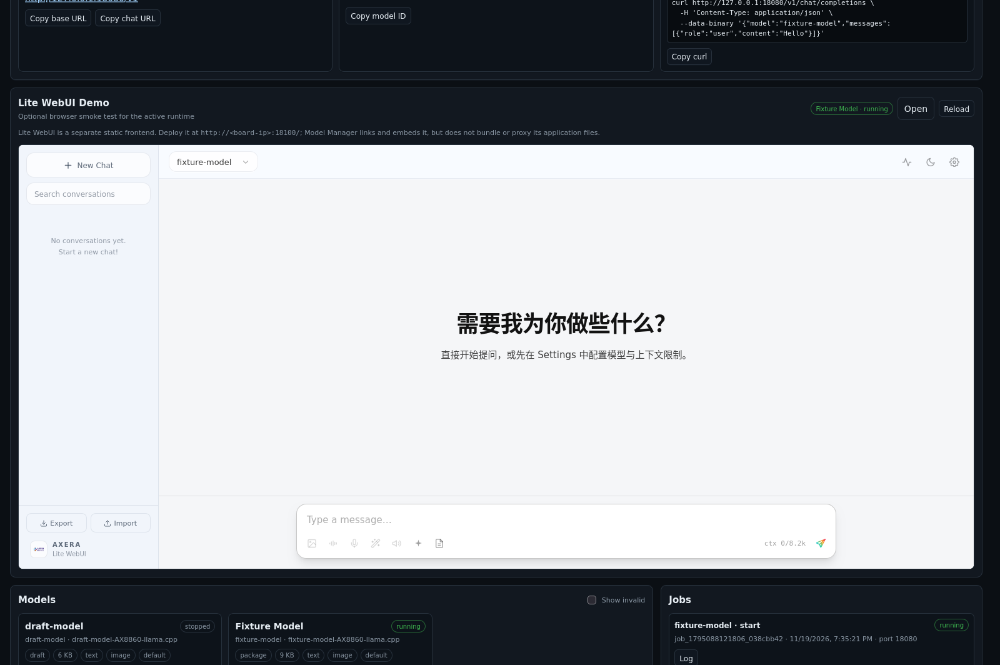

# AXERA Model Manager

AXERA Model Manager 是面向 AX8860 / AX8860P 单板的 llama.cpp 模型生命周期管理平台。
它扫描板端模型包，校验 manifest 和 artifacts，维护结构化启动 Profile，通过
systemd transient unit 拉起 llama-server，并提供任务状态、日志、审计和板卡资源观测。

项目解决的问题是：**让用户或上位机不需要手工 SSH、不需要记忆每个模型的启动参数，
也能安全地在单板上发现、配置、启动、切换和停止模型服务。**

## 目标与边界

Model Manager 只做管理平面，不做推理数据面：

```text
上位机 / Web Admin UI
    ├── Model Manager API :18090      管理、配置、任务、日志、审计、资源快照
    └── llama-server :18080-18089     OpenAI-compatible 推理 API
```

聊天、图片理解、OCR、ASR、TTS 等推理请求应直接访问 llama-server。Model Manager
不代理 prompt 和 response，避免把管理服务变成推理瓶颈。

### 核心原则

1. 模型根目录可配置，一个模型一个目录。文档中的 `<模型文件夹>` 是脱敏占位符，
   部署时替换为实际路径，不要把真实路径提交到公开文档。
2. 前端和上位机不提交任意 shell 命令，只提交结构化 JSON Profile。
3. llama-server 由 `ax-model-*` systemd transient unit 托管，Manager 重启不影响推理。
4. 停止、重启、切换前检查 llama-server `/slots`，避免误杀正在处理的请求。
5. 控制动作写入 audit。
6. 模型路径必须留在配置的 model root 内，防止路径穿越和 symlink escape。
7. tempmon 保持只读，只提供设备状态。

## 架构

```text
┌────────────────────────────┐
│ Browser Web UI / 上位机     │
└────────────┬───────────────┘
             │ HTTP + Bearer token
┌────────────▼───────────────┐
│ Model Manager API :18090   │
│ ├─ Scanner                 │
│ ├─ Manifest validator      │
│ ├─ Profile store           │
│ ├─ Job manager             │
│ ├─ Process/systemd backend │
│ ├─ Audit/log store         │
│ ├─ Resource monitor        │
│ └─ Static Web Admin UI     │
└───────┬──────────────┬─────┘
        │              │
        │ systemd-run  │ localhost /api/stats
┌───────▼────────┐ ┌───▼──────────────┐
│ llama-server   │ │ tempmon :8080    │
│ :18080-18089   │ │ OS/CMM/temp/net  │
└───────┬────────┘ └──────────────────┘
        │
        ▼ OpenAI-compatible API
Chat / Vision / OCR / ASR / TTS clients
```

### 服务与端口

| 服务 | 默认端口 | 说明 |
|---|---:|---|
| tempmon | 8080 | 只读板卡监控 agent；systemd 控制模式的启动前资源检查依赖它 |
| llama-server | 18080-18089 | 推理端口池，可同时运行多个不同模型 |
| Model Manager | 18090 | 管理 API、Web Admin UI、OpenAPI 文档 |

## 主要功能

### 模型发现与校验

- 扫描 model root 下的一级模型目录。
- 识别 `llama-server`、`llama-tts`、`llama-mtmd-cli`、`llama-cli`。
- 读取并校验 `model.json`。
- 对没有 `model.json` 的包生成 inferred draft，用户确认后保存为 user manifest。
- 校验 binary、GGUF、mmproj、acoustic、chat template、kernels。
- 返回 `errors`、`warnings`、`ready_to_start`。
- 防止 symlink escape 和路径穿越。

### Profile 与启动参数

- Profile 保存、删除、复制、重置、Diff。
- 启动前可预览实际 llama-server 命令。
- 支持 context、batch、ubatch、cache RAM、ctxcp、MTP、reasoning、端口、
  image token 上限、采样参数、线程、HTTP 线程和安全白名单环境变量。
- 支持为 llama-server 追加 `--metrics`，暴露 Prometheus 累计指标。
- 常用 context 档位：4K / 8K / 16K / 32K / 64K / 128K / 256K。

### 生命周期管理

- start / stop / restart / switch。
- 多个不同模型并行运行，自动从 18080-18089 分配端口。
- `max_running_models` 达到上限时可由用户确认 `force: true`。
- 启动前检查 CMM、OS memory 和 NPU 温度阈值。
- 停止前通过 `/slots` 做 IN USE guard。
- Manager 重启后可 reconcile runtime，支持孤儿 runtime adopt / stop。
- job 状态持久化，服务重启后仍能查看历史。

### 资源观测

- `GET /api/v1/resources` 提供当前板卡资源快照。
- CPU percent 通过 `/proc/stat` 两次采样差值计算。
- 提供 CPU load、OS used、CMM used、RX/TX、NPU 温度、llama RSS 的进程内最大值。
- `POST /api/v1/resources/max/reset` 只清除 max，不改变当前值。
- Dashboard 继续返回 `resources` 当前快照，并额外包含 `resource_monitor`。

### Web Admin UI

内置 Web UI 提供：

- Dashboard 和设备状态。
- 模型卡片、详情、manifest 和 artifacts 校验结果。
- 每个模型的启动参数配置。
- Jobs、日志尾部、错误高亮、日志下载。
- Runtime 和 OpenAI-compatible endpoint 信息。
- 可选 Lite WebUI 快速聊天演示。
- Audit 记录。
- 明暗主题。



#### Lite WebUI 快速演示

Web Admin UI 可以嵌入 Lite WebUI，用当前 running runtime 快速做一次真实
OpenAI-compatible 聊天冒烟测试。Manager 只负责生成链接：

```text
http://<board-ip>:18100/?api=http://<board-ip>:18080&model=<runtime-model-id>
```

Lite WebUI 支持 `api` 和 `model` URL 参数，被打开后会自动选中该 endpoint 和模型。
Lite WebUI 是独立静态前端，Manager 不打包、不代理、不保存它的浏览器数据。如果
未部署 Lite WebUI，请单独把它安装在：

```text
http://<board-ip>:18100/
```

### OCR / ASR / TTS 预设

当前内置稳定包推荐配置：

| 模型类型 | 预设 |
|---|---|
| MiniCPM-OCR | 4K context、batch/ubatch 256、ctxcp 8、4 GiB cache RAM |
| Qwen3-ASR | 最小 4K server 参数，不追加通用 LLM 参数 |
| VoxCPM2 | 8K context、batch 1024、8 threads、1 HTTP thread、自动加载 acoustic GGUF |
| Qwen3-TTS | 标记为 one-shot task，不作为长驻服务误启动 |

## 模型包目录规范

推荐结构：

```text
<模型文件夹>/
└── My-Model-AX8860-llama.cpp/
    ├── model.json
    ├── bin/
    │   └── llama-server
    ├── model.gguf
    ├── mmproj-model.gguf
    ├── chat_template.jinja
    └── kernels/
```

`model.json` 示例：

```json
{
  "schema_version": 1,
  "id": "my-model",
  "name": "My Model",
  "version": "1",
  "engine": "llama-server",
  "artifacts": {
    "binary": "bin/llama-server",
    "model": "model.gguf",
    "mmproj": "mmproj-model.gguf",
    "chat_template": "chat_template.jinja",
    "kernels": "kernels"
  },
  "capabilities": ["text", "image"],
  "runtime_type": "service",
  "max_context": 32768,
  "defaults": {
    "system_prompt": "You are a concise assistant.",
    "max_output_tokens": 4096,
    "kv_cache_quantization": "E4M3",
    "attention_quantization": "MXFP4",
    "speculative": {
      "type": "draft-mtp",
      "enabled": false,
      "draft_n_max": 3
    }
  },
  "profiles": {
    "default": {
      "context": 4096,
      "batch": 4096,
      "ubatch": 4096,
      "cache_ram": 0,
      "ctxcp": 0,
      "mtp": false,
      "metrics": false,
      "reasoning": "off",
      "sampling": {
        "temperature": 0
      }
    }
  }
}
```

说明：

- `id` 只能使用小写字母、数字、`.`、`_`、`-`。
- artifacts 路径必须位于模型目录内。
- `runtime_type=task` 的模型不能作为长驻 service 启动。
- `defaults` 是给上位机展示和生成请求用的模型包默认值，不是任意 shell 配置。
- `metrics=true` 会为 llama-server 追加 `--metrics`。

## 本地开发

要求：

- Python 3.10+
- curl 可选

```bash
python3 -m venv .venv
.venv/bin/pip install -r backend/requirements-dev.txt
.venv/bin/pip install -e backend

.venv/bin/python -m pytest backend/tests -q
./scripts/dev_server.sh
```

本地服务：

```text
UI:        http://127.0.0.1:18090/
API docs:  http://127.0.0.1:18090/docs
OpenAPI:   http://127.0.0.1:18090/openapi.json
Token:     local-dev-token
```

本地模式使用 fixture 和 fake subprocess，不需要真实板卡。若端口被占用：

```bash
AX_MODEL_MANAGER_PORT=18092 ./scripts/dev_server.sh
```

## 板端安装

### 前置条件

1. AX8860 / AX8860P 板卡可运行 Python 3.10+。
2. 使用 systemd。
3. 模型包已放在配置的模型根目录，例如 `<模型文件夹>`。
4. tempmon agent 已在板端 `8080` 端口运行。systemd 控制模式下，启动前资源检查依赖它。
5. llama-server 可执行文件、GGUF、mmproj、kernels 等由模型包自带。

### 安装

在板端源码目录以 root 执行：

```bash
./scripts/install.sh \
  --model-root "<模型文件夹>" \
  --data-dir /var/lib/axera-model-manager
```

首次安装会生成随机 Bearer token，并写入：

```text
/etc/axera/model-manager/config.json
```

文件权限为 `0600`。如需显式指定 token：

```bash
./scripts/install.sh \
  --model-root "<模型文件夹>" \
  --data-dir /var/lib/axera-model-manager \
  --token "<your-token>"
```

安装位置：

```text
/opt/axera-model-manager
/etc/axera/model-manager/config.json
/var/lib/axera-model-manager
```

系统服务：

```text
axera-model-manager.service
axera-model-manager-rotate.timer
axera-model-manager-rotate.service
ax-model-*.service
```

安装脚本会创建 systemd hardening 配置，并为没有 logrotate 的镜像提供每小时
copytruncate 旋转 timer。单个日志超过 50 MiB 时压缩，默认保留 14 个。

### 验证

```bash
systemctl status axera-model-manager.service --no-pager
curl http://127.0.0.1:18090/health
```

浏览器访问：

```text
http://<board-ip>:18090/
```

API 文档：

```text
http://<board-ip>:18090/docs
```

### 升级 / 回滚 / 卸载

```bash
# 升级；只停止 Manager，不停止已经运行的 ax-model-* 推理服务
./scripts/upgrade.sh

# 查看与恢复升级备份
./scripts/rollback.sh --list
./scripts/rollback.sh

# 卸载；默认保留 config、数据、日志和推理 runtime
./scripts/uninstall.sh

# 确认没有推理任务后，停止 runtime 或清理状态
./scripts/uninstall.sh --stop-runtimes
./scripts/uninstall.sh --stop-runtimes --purge
```

## 配置

参考 `config.example.json`：

```json
{
  "model_root": "<模型文件夹>",
  "manager_port": 18090,
  "llama_port_min": 18080,
  "llama_port_max": 18089,
  "data_dir": "/var/lib/axera-model-manager",
  "read_only": true,
  "enable_control": false,
  "process_backend": "none",
  "max_running_models": 1,
  "min_free_cmm_mb": 1024,
  "min_os_available_mb": 1024,
  "max_npu_temp_c": 85.0,
  "auth_token": "",
  "allowed_origins": []
}
```

关键字段：

| 字段 | 说明 |
|---|---|
| `model_root` | 模型包根目录；可在 Web Admin UI 的 Settings 中修改 |
| `llama_port_min/max` | llama-server 端口池 |
| `read_only` | true 时只允许读取 |
| `enable_control` | true 时允许启动/停止/重启/切换 |
| `process_backend` | `none`、`fake-subprocess` 或 `systemd` |
| `max_running_models` | 最大并行模型数 |
| `min_free_cmm_mb` | 启动前最小 CMM 余量 |
| `min_os_available_mb` | 启动前最小 OS 可用内存 |
| `max_npu_temp_c` | 启动前 NPU 温度阈值 |
| `auth_token` | Manager API Bearer token |
| `allowed_origins` | 浏览器跨源访问白名单 |

配置文件权限应保持 `0600`，不要提交真实 token。

### 修改模型根目录

Web Admin UI 右上角 `Settings` 可以修改 `model_root`：

```text
Model root directory
[ /mnt/tangqi ]
[Validate] [Save & Scan]
```

`Save & Scan` 会：

1. 校验路径必须是存在的绝对目录；
2. 拒绝 `/`、Manager data_dir 及其子目录；
3. 有运行中的模型时拒绝修改；
4. 保存配置；
5. 立即重新扫描该目录。

也可以直接调用：

```bash
curl -X PUT "$MANAGER/api/v1/config" \
  -H "Authorization: Bearer $TOKEN" \
  -H "Content-Type: application/json" \
  -d '{"model_root": "/mnt/tangqi"}'

curl -X POST "$MANAGER/api/v1/models/scan" \
  -H "Authorization: Bearer $TOKEN"
```

`POST /api/v1/models/scan` 返回发现的模型数量、可启动数量和扫描错误。

注意：修改 `model_root` 不会移动已有模型；旧路径下的模型会从列表中消失。

## API 调用方式

除 `/health` 外，主要 API 都需要认证：

```http
Authorization: Bearer <your-token>
```

### 1. 检查服务

```bash
MANAGER=http://<board-ip>:18090
TOKEN=<your-token>

curl "$MANAGER/health"
curl -H "Authorization: Bearer $TOKEN" "$MANAGER/api/v1/config"
```

### 2. 获取模型列表

```bash
curl -H "Authorization: Bearer $TOKEN" \
  "$MANAGER/api/v1/models"
```

返回模型摘要、能力、manifest 状态、profiles、active job 和校验结果。

### 3. 校验模型

```bash
curl -H "Authorization: Bearer $TOKEN" \
  "$MANAGER/api/v1/models/<model-id>/validate"
```

### 4. 预览启动命令

```bash
curl -X POST "$MANAGER/api/v1/models/<model-id>/preview" \
  -H "Authorization: Bearer $TOKEN" \
  -H "Content-Type: application/json" \
  -d '{
    "profile": "default",
    "context": 4096,
    "batch": 4096,
    "ubatch": 4096,
    "mtp": false,
    "metrics": false,
    "sampling": {"temperature": 0}
  }'
```

### 5. 启动模型

```bash
curl -X POST "$MANAGER/api/v1/models/<model-id>/start" \
  -H "Authorization: Bearer $TOKEN" \
  -H "Content-Type: application/json" \
  -d '{
    "profile": "default",
    "context": 4096,
    "batch": 4096,
    "ubatch": 4096,
    "mtp": false,
    "metrics": false,
    "sampling": {"temperature": 0}
  }'
```

返回 job。启动是异步的，需要轮询：

```bash
curl -H "Authorization: Bearer $TOKEN" \
  "$MANAGER/api/v1/jobs/<job-id>"
```

job 进入 `running` 后，从返回值读取：

```text
port
runtime_endpoint
runtime_models
log_path
```

注意：`runtime_endpoint` 是板端本机视角，通常是 `http://127.0.0.1:<port>`。
上位机应访问：

```text
http://<board-ip>:<port>
```

### 6. 直接调用 llama-server

先查询实际 model ID：

```bash
RUNTIME=http://<board-ip>:18080
curl "$RUNTIME/v1/models"
```

发送 chat 请求：

```bash
curl -X POST "$RUNTIME/v1/chat/completions" \
  -H "Content-Type: application/json" \
  -d '{
    "model": "<runtime-model-id>",
    "messages": [
      {"role": "user", "content": "你好，请介绍一下你自己。"}
    ],
    "stream": true
  }'
```

最终 usage / timings 可提供：

```text
prompt_tokens
completion_tokens
cached_tokens
prompt_ms
prompt_per_second
predicted_ms
predicted_per_second
predicted_per_token_ms
```

上位机可自行记录 wall time 来计算 TTFT 和 E2E。

### 7. 查看资源状态

```bash
curl -H "Authorization: Bearer $TOKEN" "$MANAGER/api/v1/resources"
```

返回当前 OS/CMM、CPU percent、load、NPU 温度、磁盘、网络、llama 进程，以及
Manager 进程内维护的资源最大值：

```json
{
  "current": {
    "cpu_percent": 3.25,
    "os_memory": {},
    "cmm": {},
    "net": {},
    "npu": {}
  },
  "max": {
    "cpu_percent": 3.25,
    "os_used_kb": 1,
    "cmm_used_kb": 1,
    "rx_mbps": 0.0,
    "tx_mbps": 0.0,
    "npu_temp_c": 40.0,
    "llama_rss_kb": 1
  },
  "sample_count": 1,
  "sampling": "on-request"
}
```

清除最大值：

```bash
curl -X POST "$MANAGER/api/v1/resources/max/reset" \
  -H "Authorization: Bearer $TOKEN"
```

聚合视图仍可使用：

```bash
curl -H "Authorization: Bearer $TOKEN" \
  "$MANAGER/api/v1/dashboard"
```

### 8. 停止模型

```bash
curl -X POST "$MANAGER/api/v1/models/<model-id>/stop" \
  -H "Authorization: Bearer $TOKEN" \
  -H "Content-Type: application/json" \
  -d '{"mode": "block", "timeout_seconds": 5}'
```

如果 `/slots` 显示模型正在处理请求，默认停止会被拒绝。确认风险后可传：

```json
{"mode": "block", "timeout_seconds": 5, "force": true}
```

### 9. 查看任务日志与审计

```bash
curl -H "Authorization: Bearer $TOKEN" \
  "$MANAGER/api/v1/jobs/<job-id>/logs?lines=200"

curl -H "Authorization: Bearer $TOKEN" \
  "$MANAGER/api/v1/audit"
```

## API 总览

| Method | Path | 说明 |
|---|---|---|
| GET | `/health` | 公开健康检查、版本和模式 |
| GET | `/api/v1/config` | 读取配置，不返回 token |
| PUT | `/api/v1/config` | 修改最大并行模型数 |
| GET | `/api/v1/models` | 模型列表 |
| GET | `/api/v1/models/{id}` | 模型详情和最近任务 |
| GET | `/api/v1/models/{id}/manifest` | 读取 manifest |
| POST | `/api/v1/models/{id}/manifest/confirm` | 确认 inferred manifest |
| GET | `/api/v1/models/{id}/validate` | 校验 manifest 和 artifacts |
| PUT | `/api/v1/models/{id}/profiles/{profile}` | 保存 profile |
| DELETE | `/api/v1/models/{id}/profiles/{profile}` | 删除 profile |
| POST | `/api/v1/models/{id}/profiles/{profile}/duplicate` | 复制 profile |
| POST | `/api/v1/models/{id}/profiles/{profile}/reset` | 重置 profile |
| GET | `/api/v1/models/{id}/profiles/{left}/diff/{right}` | Profile diff |
| POST | `/api/v1/models/{id}/preview` | 预览启动命令 |
| POST | `/api/v1/models/{id}/start` | 启动模型 |
| POST | `/api/v1/models/{id}/stop` | 停止模型 |
| POST | `/api/v1/models/{id}/restart` | 重启模型 |
| POST | `/api/v1/models/{id}/switch-to` | 切换模型 |
| GET | `/api/v1/runtimes` | Runtime reconcile 和孤儿扫描 |
| POST | `/api/v1/runtimes/{runtime_id}/adopt` | 接管孤儿 runtime |
| POST | `/api/v1/runtimes/{runtime_id}/stop` | 停止孤儿 runtime |
| GET | `/api/v1/jobs` | Job 列表 |
| GET | `/api/v1/jobs/{job_id}` | Job 状态 |
| GET | `/api/v1/jobs/{job_id}/logs` | Job 日志 |
| GET | `/api/v1/audit` | 审计记录 |
| GET | `/api/v1/dashboard` | 聚合 dashboard 与资源快照 |
| GET | `/api/v1/resources` | 当前资源、CPU percent 和资源最大值 |
| POST | `/api/v1/resources/max/reset` | 清除资源最大值 |

机器可读接口定义：

```text
/openapi.json
/docs
```

## 打包与回归

```bash
./scripts/package.sh

AX_MODEL_MANAGER_TOKEN="$TOKEN" \
  ./scripts/regression.sh http://<board-ip>:18090
```

Release 包不包含 `.git`、`.venv`、`dist`、`.secrets` 和本地 fixture。

日常真板生命周期测试默认使用小型文本模型；大模型只用于内存、长上下文、性能或
客户指定专项，不作为默认回归模型。

## 安全说明

- Manager 控制 API 使用单一 Bearer token，适合调试和单机送测阶段。
- token 保存在板端配置文件中，配置权限应为 `0600`。
- 不要把 token、真实板卡 IP、密码或私有模型路径提交到 Git。
- 浏览器 Web 上位机直连 Manager 时需要配置 `allowed_origins`。
- 当前没有多用户、角色、租户和细粒度权限体系。
- 生产暴露到不可信网络前，应增加 HTTPS、反向代理、审计和权限控制。

## 当前限制

- 不负责模型下载或 Hugging Face 差异化更新。
- 不代理 OpenAI 推理流量。
- 没有 NPU utilization；当前提供温度、频率、进程和内存状态。
- 资源 max 保存在 Manager 进程内，Manager 重启后重建。
- llama-server 当前由 Manager 固定以 `-np 1` 启动，多个请求会在同一服务内排队。
- Manager 的多模型并行不等价于同一个模型的多 batch 并行推理。
- ViT 单独耗时未从 llama-server response 中拆出。

## 目录结构

```text
backend/
  ax_model_manager/   FastAPI 服务、扫描、manifest、进程与 job 管理
  static/             内置 Web Admin UI
  tests/              单元与 API 测试
scripts/
  install.sh          板端安装
  upgrade.sh          升级
  rollback.sh         回滚
  uninstall.sh        卸载
  package.sh          打包
  regression.sh       API/UI 冒烟回归
```

上位机开发同事可按本文的 “目标与边界”、“API 调用方式” 和 “当前限制” 章节对接。
第三方 UI / 上位机团队优先阅读
[`docs/third-party-ui-integration.md`](docs/third-party-ui-integration.md)。

更偏项目维护者和 coding agent 的架构上下文、开发守则见
[`docs/skills.md`](docs/skills.md)。

## 版本

当前版本见 `VERSION`，发布历史见 `RELEASES.md`。

## License

MIT License. See [LICENSE](LICENSE).
