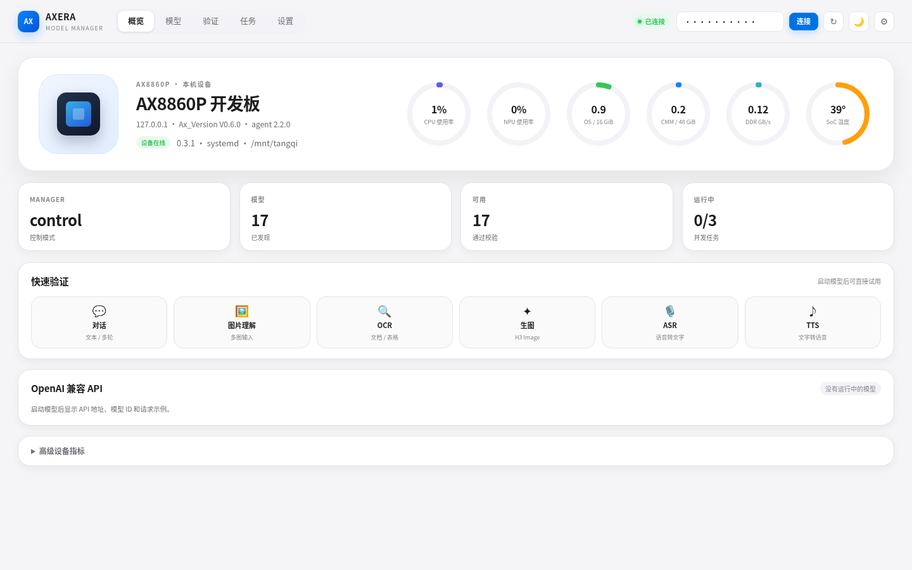
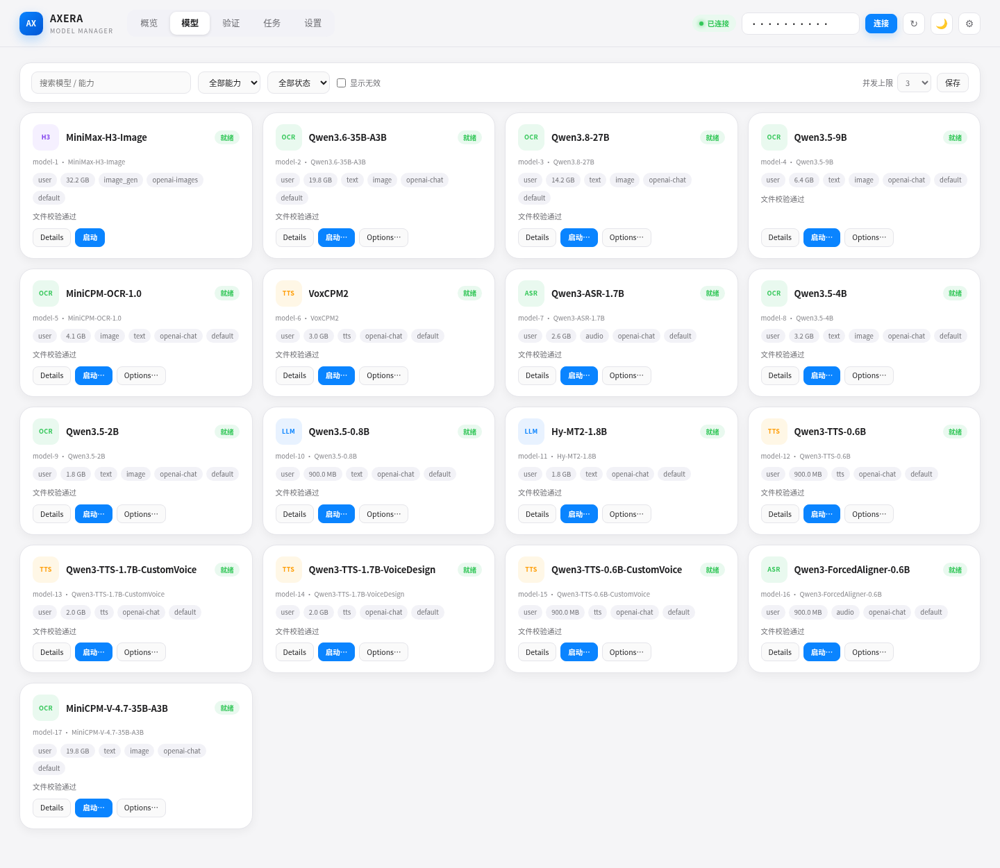

# AXERA Model Manager

[](https://github.com/AXERA-TECH/ax-model-manager/actions/workflows/ci.yml)
[](LICENSE)

**AXERA Model Manager** 是面向 AX8860 / AX8860P 单板的 llama.cpp 模型生命周期管理平台。
它扫描板端模型包，校验 manifest 和 artifacts，维护结构化启动 Profile，通过 systemd
transient unit 拉起 llama-server，并提供任务状态、日志、审计和板卡资源观测。

它解决的问题是：

```text
不需要手工 SSH
不需要记忆每个模型的启动参数
也能在单板上发现、配置、启动、切换和停止模型服务
```



---

## 架构

Model Manager 只做管理平面，不做推理数据面：

```text
上位机 / Web Admin UI
    ├── Model Manager API :18090      管理、配置、任务、日志、审计、资源快照
    └── llama-server :18080-18089     OpenAI-compatible 推理 API
```

聊天、图片理解、OCR、ASR、TTS 等推理请求应直接访问 llama-server。Manager 不代理
prompt 和 response。

默认端口：

| 服务 | 端口 | 说明 |
|---|---:|---|
| [tempmon](https://github.com/AXERA-TECH/tempmon) | 8080 | 只读板卡监控 agent；资源检查依赖它 |
| llama-server | 18080–18089 | 推理端口池 |
| Model Manager | 18090 | 管理 API、Web Admin UI、OpenAPI 文档 |

---

## 快速开始

### 1. 本地开发

要求：

```text
Python 3.10+
```

```bash
python3 -m venv .venv
.venv/bin/pip install -r backend/requirements-dev.txt
.venv/bin/pip install -e backend

.venv/bin/python -m pytest backend/tests -q
./scripts/dev_server.sh
```

打开：

```text
http://127.0.0.1:18090/
```

本地模式使用 fixture 和 fake subprocess，不需要真实板卡。

### 2. 板端安装

前置条件：

```text
AX8860 / AX8860P
Python 3.10+
systemd
tempmon agent 已在 8080 运行
模型包已放到模型根目录
```

tempmon 是独立项目，不包含在本仓库中：

```text
https://github.com/AXERA-TECH/tempmon
```

安装：

```bash
./scripts/install.sh \
  --model-root "<model-root>" \
  --data-dir /var/lib/axera-model-manager
```

验证：

```bash
systemctl status axera-model-manager.service --no-pager
curl http://127.0.0.1:18090/health
```

浏览器访问：

```text
http://<board-ip>:18090/
```

---



## Web Admin UI

界面为中文，分为五个标签：

- **概览**：设备状态、CPU / NPU 使用率、OS / CMM 内存、DDR 带宽、SoC 温度、快速验证入口、OpenAI 兼容 API。
- **模型**：模型卡片、搜索、能力筛选、状态筛选（全部 / 已启动 / 已停止 / 可启动 / 异常）、详情、启动参数。
- **验证**：LiteWebUI 嵌入、快速入口、接口地址。
- **任务**：Jobs、终端风格日志、审计。
- **设置**：模型根目录、Manager 端口、进程后端、Agent / BSP、主题。

多个模型运行时，API 面板用标签切换，一次显示一个模型的 Base URL / 模型 ID / 请求示例。
「预览命令」输出可直接复制的 shell 脚本（`cd` + `export` + 反斜杠续行）。

## 主要能力

- 模型发现、`model.json` 校验、artifact 检查
- 启动参数 Profile：保存、复制、重置、Diff、预览
- start / stop / restart / switch
- 多模型端口池：18080–18089
- 启动前 CMM / OS / SoC 温度检查
- 停止前 `/slots` busy guard，停止过程显示「停止中」并禁止重复启动
- job、终端风格日志、审计、runtime 恢复
- 中文 Web Admin UI（概览 / 模型 / 验证 / 任务 / 设置）+ 可选 Lite WebUI 聊天演示
- 模型状态筛选：全部 / 已启动 / 已停止 / 可启动 / 异常
- 多运行时 API 标签切换，生图模型显示 Images API 和网页入口
- 模型目录扫描 10 秒缓存，「刷新」按钮强制重扫
- OS / CMM / CPU / 网络 / NPU / DDR 带宽 / llama RSS 资源监控
- 模型根目录可在 Web UI 的 Settings 中修改

---

## 文档

- [用户指南](docs/USER_GUIDE.md)：模型包规范、安装、配置、API、打包回归、安全说明
- [第三方 UI 对接](docs/third-party-ui-integration.md)：给上位机 / Web UI 团队的接入说明
- [图像生成模型接入](docs/image-generation.md)：H3 Image / axdiffusion 的部署与 API 用法
- [Agent / Skills 指南](docs/skills.md)：项目结构、API 调用流程、开发守则
- [AXERA tempmon](https://github.com/AXERA-TECH/tempmon)：板端只读监控 agent

---

## 当前边界

- 不负责模型下载或 Hugging Face 差异化更新。
- 不代理 OpenAI 推理流量。
- 资源 max 保存在 Manager 进程内，重启后重建。
- llama-server 当前固定 `-np 1`，多请求在同一服务内排队。
- 多模型并行不等价于同一个模型的多 batch 并行推理。
- 不包含 tempmon agent，需单独安装。

---

## License

MIT License，见 [LICENSE](LICENSE)。
